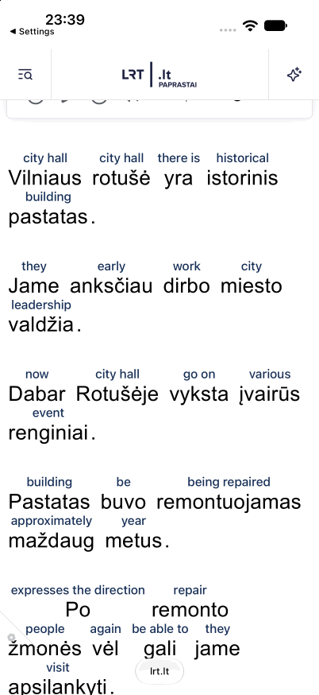
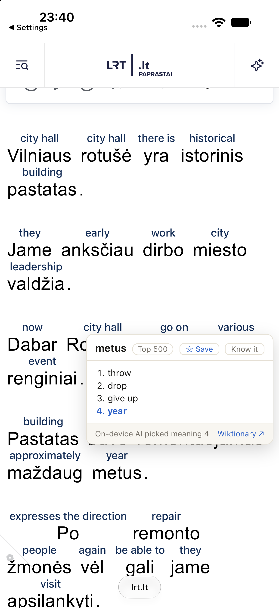
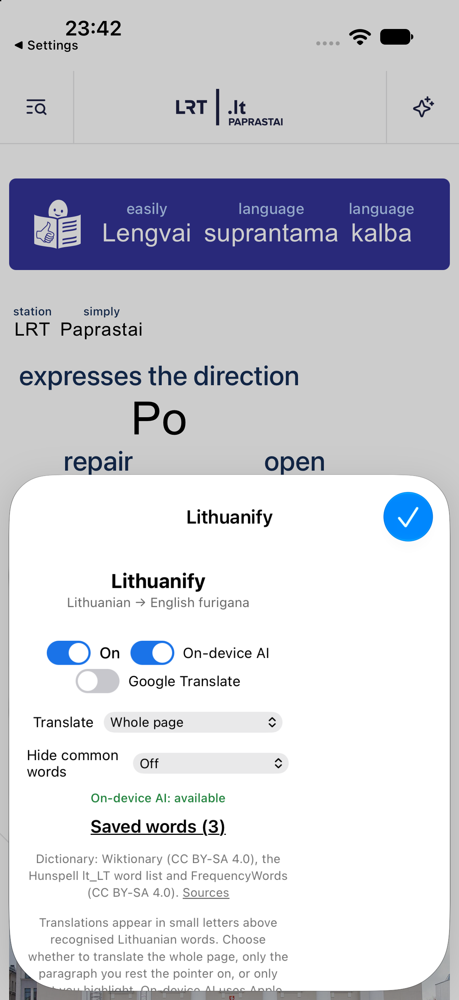
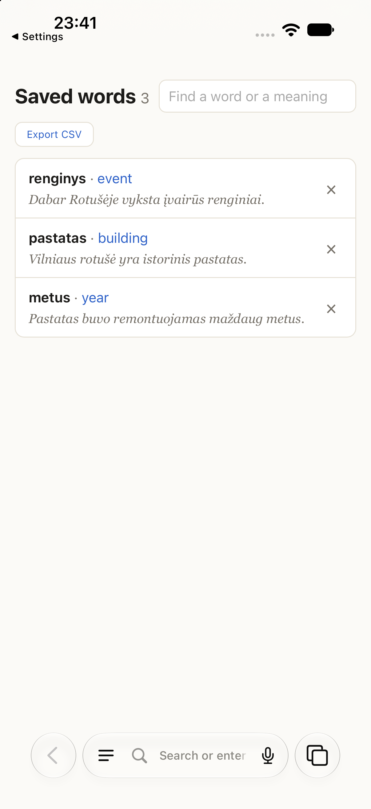

<p align="center">
  
</p>

<h1 align="center">Lithuanify</h1>

<p align="center">
  A Safari Web Extension that shows English translations in small letters
  <strong>above</strong> Lithuanian words as you read — like Japanese <em>furigana</em>.
</p>

> The logo is an **Iron Wolf** (*Geležinis Vilkas*) — an homage to the legend of
> Grand Duke Gediminas, whose dream of an iron wolf howling on a hilltop led him
> to found **Vilnius**.

Lithuanian text on a page is annotated in place with `<ruby>` elements, so each
word keeps its original form while a concise English gloss sits on top.

## Screenshots

<p align="center">
  
</p>

| Glosses as you read | Word card | Toolbar popup | Saved words |
|:---:|:---:|:---:|:---:|
|  |  |  |  |

Safari on iPhone (iOS 27.3 Simulator), reading
[*Po remonto atidaryta Vilniaus rotušė*](https://www.lrt.lt/naujienos/lrt-paprastai/69/3124115/po-remonto-atidaryta-vilniaus-rotuse)
from LRT Paprastai, LRT.lt's section in easy-to-read Lithuanian. Glosses come
from the dictionary and the on-device AI; Google Translate was off. They are
real output, mistakes included.

## How translation works

Lithuanify runs **entirely on your device**, in two tiers:

1. **Offline dictionary (instant).** A built-in list of common Lithuanian words
   is rendered in the first frame, before any model work starts.
2. **On-device AI (fills the gaps).** Words the dictionary doesn't know are sent,
   batched by what's on screen, to Apple's [FoundationModels](https://developer.apple.com/documentation/foundationmodels)
   framework (Apple Intelligence), which returns a *context-aware* meaning for
   each one. The model only returns a number and a meaning per word, so its
   output stays short. Requires Apple Intelligence on a supported device.

Nothing is sent to the network unless you turn on Google Translate (below).
Model results are cached per text block in IndexedDB, so revisited pages
don't touch the model again. Pages that don't look Lithuanian are left alone.

### Optional: Google Translate as context

Apple's on-device model is much stronger in English than in Lithuanian. With
Google Translate turned on, each paragraph that goes to the on-device model is
first translated into English by Google, and the model reads that English
sentence to pick a better meaning for each word. Glosses stay word by word;
Google's translation is only context.

**You need your own Google Cloud API key.** Lithuanify ships no key and no
server, so the feature is off until you add one.

- **Needs:** the on-device AI switched on and available (Apple Intelligence).
  Without it the Google Translate switch is greyed out, because there is no
  model to read the English.
- **Privacy:** off by default. When on, **the text of each paragraph sent to the
  on-device model goes to Google**. Dictionary glosses, saved words and
  everything else stay on the device. Read
  [Google's data use for Cloud Translation](https://cloud.google.com/translate/data-usage)
  before you turn it on.
- **Cost:** it uses Cloud Translation *Basic* (v2), billed per character. Google
  gives a free monthly allowance (500,000 characters a month at the time of
  writing); check the current [pricing](https://cloud.google.com/translate/pricing).
  Daily reading usually stays inside it. A small budget alert in Google Cloud
  billing is a good idea.

#### Set up a key

1. In the [Google Cloud console](https://console.cloud.google.com/), create a
   project (or pick one) and attach a billing account. The API needs billing
   even inside the free allowance.
2. Enable the **Cloud Translation API** for that project.
3. Open **APIs & Services → Credentials → Create credentials → API key**.
4. Edit the key:
   - **API restrictions:** *Restrict key* and select only **Cloud Translation
     API**, so a leaked key can't be used for anything else.
   - **Application restrictions:** leave **None**. *Websites* and *iOS apps*
     would block Lithuanify, whose requests come from the extension, not from a
     website or an app with a bundle header.
5. In Safari, open the Lithuanify toolbar popup, turn on **Google Translate**,
   and paste the key into the field under it.
6. Open a new Lithuanian page. If Safari asks to allow Lithuanify on
   `translation.googleapis.com`, allow it.

The key stays in the extension's local storage on that device (it is not
synced) and is sent only to Google, in the `X-Goog-Api-Key` request header,
never in a URL. Turn the switch off to stop all requests; clear the field to
remove the key.

#### If it doesn't seem to work

- Pages you have read before keep their cached meanings; try a new page.
- Any Google error leaves the page glossed as it would be without Google. The
  Web Inspector console of the extension's background page shows a line such
  as `[Lithuanify] Google Translate: HTTP 403`: 400 or 403 usually means a
  wrong key, a key restricted to another API, the API not enabled, or no
  billing account; 429 means a quota limit.

> Note: Apple's *Translation* framework can't be used here: it has no Lithuanian
> (`LanguageAvailability` reports lt → en as unsupported). FoundationModels
> doesn't list Lithuanian among its supported languages either, so its meanings
> are a best effort: the dictionary comes first, and the model mostly picks
> among dictionary meanings or fills in words the dictionary lacks.

## Features

- Furigana-style English glosses above Lithuanian words.
- **Three translate modes**, picked in the toolbar popup:
  - *Whole page*: every word, on-screen text first.
  - *Paragraph under pointer*: only the paragraph the pointer rests on.
  - *Selected text*: only the words you highlight. This also works on pages
    that don't look Lithuanian. On iPhone and iPad, where there is no hover,
    this is the mode to use.
- Context-aware meanings via the on-device language model, optionally helped
  by a Google Translate sentence translation (opt-in, with your own API key;
  see [Optional: Google Translate as context](#optional-google-translate-as-context)).
- **Word cards:** tap a gloss for its lemma, every meaning, where the meaning
  came from and a Wiktionary link. **Save** a word, or mark it **known** to
  hide its glosses everywhere. The **Saved words** page (from the popup)
  lists, finds, removes and exports them as CSV for Anki.
- **Priority + visible-first scheduling:** on-screen text translates first, then
  the rest fills in by priority (title → body → navigation/menus last).
- **Foreground-only:** only the active tab spends the model; background tabs pause.
- **Performance:** dictionary glosses render instantly; a prewarmed model
  session is reused per request; a persistent IndexedDB gloss cache makes
  revisits instant. Timings are logged to the Web Inspector console.
- Diacritic-insensitive dictionary matching.
- Toolbar popup to toggle the extension, the on-device AI and Google Translate,
  pick the translate mode, hide common words, see whether the on-device model
  is available, and open Saved words.

## Project layout

| Path | Purpose |
|------|---------|
| `Shared (Extension)/Resources/content.js` | Page scanning, furigana rendering, scheduling |
| `Shared (Extension)/Resources/background.js` | Bridges JS ↔ native, gloss cache (IndexedDB), dictionary lookups |
| `Shared (Extension)/Resources/dictionary/` | The built dictionary (`lt-en.tsv`) and its data licences |
| `scripts/build-dictionary.mjs` | Builds the dictionary from Wiktionary and Hunspell lt_LT |
| `Shared (Extension)/Resources/popup.*` | Toolbar popup UI |
| `Shared (Extension)/SafariWebExtensionHandler.swift` | Native handler: the on-device model session |
| `Packages/LithuanifyCore` | Gloss logic (prompt, jobs, parsing, cleaning) and its Swift tests |
| `tests/js` | Tests for `content.js` and `background.js` |
| `scripts/check` | Runs every test and both builds |
| `Shared (App)/` | Container app that hosts and enables the extension |

## Building & running

1. Open `Lithuanify.xcodeproj` in Xcode.
2. Select the **Lithuanify (macOS)** scheme and run it once (this registers the
   extension with Safari).
3. In Safari: **Settings → Advanced →** enable *Show features for web developers*.
4. **Develop → Allow Unsigned Extensions** (needs redoing each Safari launch for
   development builds).
5. **Settings → Extensions →** enable **Lithuanify** and allow it on every website.
6. Visit a Lithuanian page (e.g. `lt.wikipedia.org`) — English glosses appear
   above recognised words.

## Checks

Run one command before each commit:

```bash
./scripts/check
```

It runs the Swift tests of `Packages/LithuanifyCore` (Swift Testing), the
JavaScript tests in `tests/js` (`node:test` with jsdom and fake-indexeddb),
and builds the macOS and iOS targets. It stops at the first failure.
`./scripts/check --tests-only` skips the two builds. The first run does an
`npm ci`; the test libraries are for development only and do not ship.
GitHub Actions runs the same checks on each push to `main` and each pull
request (`.github/workflows/check.yml`).

## Dictionary data

The dictionary has one line per Lithuanian lemma: its short English meaning, the lemma, and every inflected form. To build it again:

```bash
node scripts/build-dictionary.mjs
```

The script downloads its sources into `build/dictionary` (about 620 MB, mostly the gzipped English Wiktionary; ignored by git) and writes `Shared (Extension)/Resources/dictionary/`.

- English meanings and word forms: [Wiktionary](https://en.wiktionary.org), extracted by [Wiktextract](https://kaikki.org/dictionary/Lithuanian/), under [CC BY-SA 4.0](https://creativecommons.org/licenses/by-sa/4.0/). Words with no Lithuanian entry of their own get meanings from the translation tables of English Wiktionary's entries ([the English extraction](https://kaikki.org/dictionary/English/)).
- More word forms: the [Hunspell lt_LT](https://github.com/LibreOffice/dictionaries/tree/master/lt_LT) word list from LibreOffice, under the licence in `LICENSE-hunspell-lt.txt`.
- Word frequency ranks: [FrequencyWords](https://github.com/hermitdave/FrequencyWords) by Hermit Dave, from OpenSubtitles, under CC BY-SA 4.0 (see `LICENSE-frequencywords.txt`). The popup's **Hide common words** setting uses them.

## Requirements

- Xcode 26 or later. The app and the extension need **iOS 26** or **macOS 26**.
- For the on-device AI path: a device with **Apple Intelligence** enabled.
  Without it, Lithuanify uses the offline dictionary only.
- For the optional Google Translate context: the on-device AI above, plus your
  own Google Cloud **Cloud Translation API key** with billing enabled (see
  [Set up a key](#set-up-a-key)).

## License

[MIT](LICENSE)
